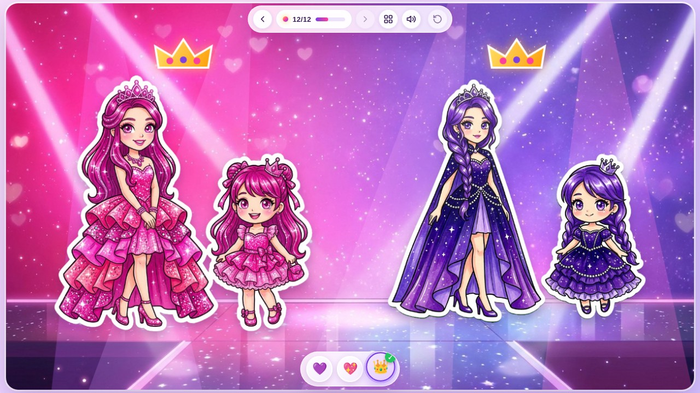

# PINK vs. PURPLE Huntrix Dress-Up Studio

Interactive browser & iPad paper-doll crafting and runway dress-up studio faithfully reproducing [**PINK vs. PURPLE Huntrix Dress-Up | Designing a Dream Dress!**](https://youtu.be/znyzrXWXHyE) by *The Crinkly Tingles*.

**Live Game**: https://kunruiw1991.github.io/huntrix-pink-vs-purple-dressup/

## Highlights
- **12 Chronological Interactive Steps**:
  1. Split Pink vs. Purple Bedroom Contest Invite & Chained `MY DESIGN BOOK` Unlock
  2. Team Purple (`Rumi + Mini Rumi`): Blue `?` Mystery Box & Rainbow Color Wheel Spin
  3. Fine-Liner Pen Dress Sketch inside `MY DESIGN BOOK`
  4. Flower-Shaped Watercolor Palette Cosmic Galaxy Painting
  5. Golden Craft Scissors Cutout & Crystal Pearl/Star Rhinestone Placement
  6. Purple Starry Aurora Runway Dress-Up, Purple Heels & Heart Shimmer Makeup
  7. Team Pink (`Mira + Mini Mira`): Pink Badge & Rainbow Color Wheel Spin
  8. Fine-Liner Pen Ruffled Rose Ballgown & Tutu Sketch
  9. Alcohol Markers + Pink Glitter Pots + **White Handheld Mini Fan** Glitter Dryer
  10. **`3×3` Pink Memory Match Shoes Mini-Game** (*Play Game to Get Shoes*)
  11. Pink Cotton-Candy Runway Dress-Up, Unlocked Pink Heels & Glitter Shimmer
  12. **Grand PINK vs. PURPLE Concert Spotlight Runway Showdown** & Interactive Crown Vote
- **Streamlined Wordless Floating-Pill UI**: Instant-play on load, frosted floating top & bottom icon pills, pure visual 12-scene thumbnail gallery (`▦`), inline `✓`/`✕` destructive reset confirmation, zero horizontal overflow across Desktop, iPad, and Mobile.
- **Procedural ASMR Web Audio**: Paper crinkles, chain unlock, wheel ticks, pen strokes, brush swishes, golden scissor snips, pearl pops, glitter shakes, white mini fan breeze, card flips, and runway sparkle fanfare.

## Verification & Cross-Model QA
- Unit Tests: `node --test --experimental-test-coverage tests/unit.test.js`
- Multi-Viewport Playwright E2E + Comparison Grid: `python3 tests/e2e_verify.py`
- Side-by-side visual audit grid: [`.qa/comparison_grid.png`](.qa/comparison_grid.png)
- External Auditors configured for **Claude Opus 5.5 (`extra`)** and **Codex GPT Astra (`medium`)** via GitHub PR (`@claude` + `@codex review`).
